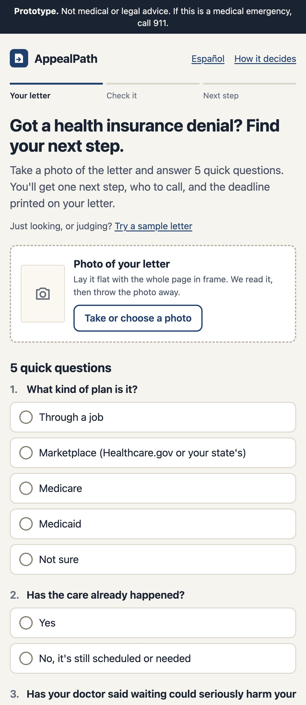
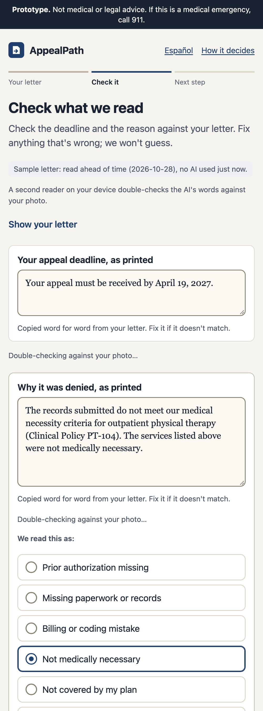
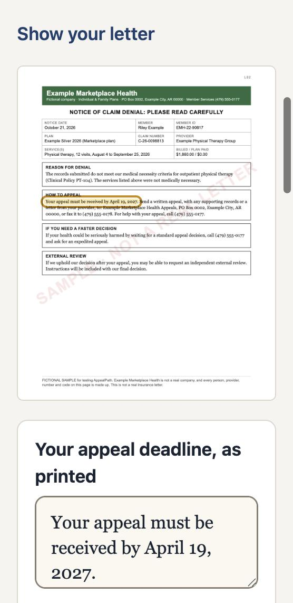
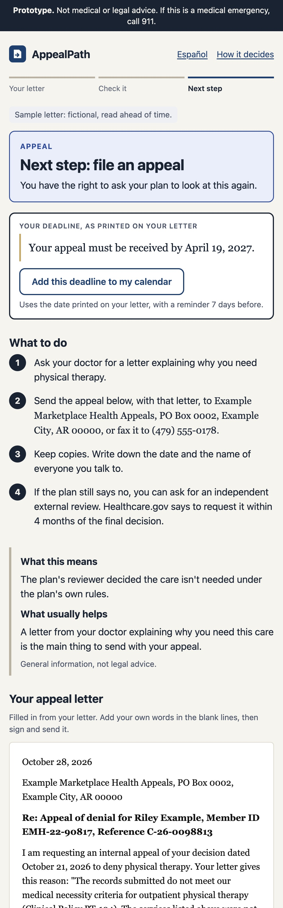
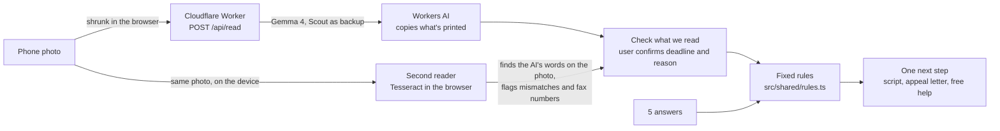

# AppealPath

**Take a photo of a health insurance denial letter, answer 5 questions, and get one next step:** fix and resubmit, appeal, or ask for an urgent review today. Medicare, Medicaid and unclear letters get "call the number on your letter" instead of a guess. In English and Spanish.

*Prototype, not medical or legal advice.* Built solo for DSH Hacks V2 (AI × Healthcare). All test letters are fictional.

**Try it:** https://appealpath.7zhvt4rjzh.workers.dev · Jump straight to a sample: [check screen](https://appealpath.7zhvt4rjzh.workers.dev/?sample=L02) · [appeal result](https://appealpath.7zhvt4rjzh.workers.dev/?sample=L02&result) · [urgent result](https://appealpath.7zhvt4rjzh.workers.dev/?sample=L03&result) · [how it decides](https://appealpath.7zhvt4rjzh.workers.dev/#how)

| Your letter | Check what we read | Second reader | Next step |
|---|---|---|---|
|  |  |  |  |

## How it works

- **The AI reads; the rules decide.** The model only copies text into fields. Five fixed rules, each with a source or labeled as a design choice (`prep/ROUTING.md`), pick the next step.
- **Two readers, and the user checks.** The model rated itself 100% sure on a sentence it copied with a word missing, so its confidence is never trusted. A second, independent reader runs on the device and looks for the AI's exact words on the photo. It can highlight where they're printed, and it flags anything it can't find, including fax numbers picked as phone numbers. The user always checks the deadline and the reason before seeing a result.
- **Never a made-up deadline.** The app quotes the deadline printed on the letter. If the letter prints a date, the user can add it to their calendar. If no deadline is printed, the app says so.
- **Nothing stored.** No accounts, no database. The photo goes to Workers AI to be read and is then dropped. Reads are limited to about 6 a minute per visitor.

## How well it works

| Images | Right next step, no fixes | Second reader |
|---|---|---|
| 12 clean digital images of the letters | **12 / 12** | Confirmed 21 of 21 correct values; flagged 2 of 2 wrong ones |
| 14 simulated phone-like images (tilted, blurred, shadowed, heavily compressed) | **14 / 14** | Confirmed 22 of 24 correct values; flagged 2 of 2 wrong ones |

Known misses: on 2–3 letters the AI picked the fax number as the phone, and the second reader flagged every one. On one letter it read "out of network" as "not covered", which leads to the same next step. The reading instructions were tuned on these same fictional letters, so treat these numbers as a best case; real phone photos haven't been measured yet. Details: `public/accuracy.json`, `prep/READER-TEST.md`.

## Accessibility

Checked against WCAG 2.1 AA (`prep/ACCESSIBILITY.md`): 7 issues found and fixed. That covered contrast in light and dark mode, focus visibility, tap targets, focus moving to each new screen, and language tags for Spanish. Not yet tested with a real screen reader.

## Run it

| Task | Command |
|---|---|
| Local dev (builds the app, then `wrangler dev` on :8792) | `npm run dev` |
| Rebuild the app on change | `npm run dev:watch` |
| Typecheck (Worker + app) | `npm run typecheck` |
| Tests (rules on all 12 letters, reader output, second-reader matching, printed dates) | `npm test` |
| Deploy to workers.dev (typecheck, tests, build, then `wrangler deploy`) | `npm run deploy` |
| Re-capture the 3 sample readings (dev server running; about 45 neurons) | `node scripts/capture-samples.mjs` |
| Make the phone-like test images (macOS) | `bash scripts/phone-like.sh` |
| Measure a folder of images (dev server running; about 14 neurons each) | `node scripts/measure.mjs photos "phone photos"` |

Local dev uses real Workers AI on your account, so reads count against the free 10,000 neurons a day, which SnapList shares.

## What's here

| Path | What it is |
|---|---|
| `src/shared/rules.ts` | The 5 routing rules, in order |
| `src/shared/match.ts` | The second reader's matching: finds a quote or phone number in the OCR words |
| `src/shared/dates.ts` | Reads a printed date for the calendar reminder; never calculates one |
| `src/read.ts` | The letter reader: schema, instructions, Gemma then Scout, strict output check |
| `src/worker.ts` | `POST /api/read` with the rate limit; everything else is static files in `public/` |
| `src/client/` | The Preact app; all text in `i18n.ts` (English and Spanish) |
| `public/samples/` | The 3 demo letters and their readings, captured ahead of time from the real model |
| `test-letters/` | 12 fictional letters (PDF) and the answer key (Markdown + JSON) |
| `prep/` | Routing sources, screen wording, demo script, one-pager, reader test, accessibility audit |

## Still to do (Noah)

- [ ] Post the DSH questions on Discord (video limit, zip requirement, the stale Nov 8 date, prize delivery for minors).
- [ ] Print `test-letters/letters.pdf`, take the 14 photos into `photos/`, and run `node scripts/measure.mjs photos "phone photos"`.
- [ ] Show it to 2–3 real people and write down what they say, word for word.
- [ ] Have a native Spanish speaker review `src/client/i18n.ts` (the app says the translation hasn't been reviewed yet).
- [ ] Do a 5-minute VoiceOver pass on an iPhone.
- [ ] Record the demo (`prep/DEMO-SCRIPT.md`) and add its link to the one-pager.

## Rules for this project

- Synthetic letters only; no real patient data. Every page says "Prototype. Not medical or legal advice."
- The AI reads; fixed rules decide; the user checks the deadline and reason before any result. The deadline is never calculated.
- Free tools only. No secrets in code or config.

MIT License.
