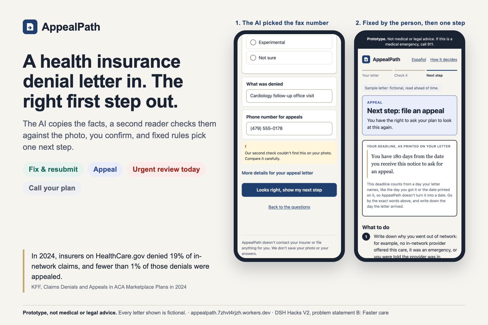
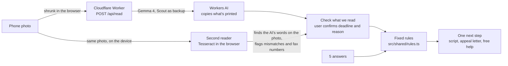

# AppealPath

**Take a photo of a health insurance denial letter, answer 5 questions, and get one next step:** fix and resubmit, appeal, or ask for an urgent review today. Medicare, Medicaid and unclear letters get "call the number on your letter" instead of a guess. In English and Spanish.

*Prototype, not medical or legal advice.* Built solo for DSH Hacks V2 (AI × Healthcare). All test letters are fictional.

**Try it:** https://appealpath.7zhvt4rjzh.workers.dev · [See the AI pick a fax number and the check warn about it](https://appealpath.7zhvt4rjzh.workers.dev/?sample=L04) · One fictional sample per rule: [Fix & resubmit](https://appealpath.7zhvt4rjzh.workers.dev/?sample=L01&result) · [Appeal](https://appealpath.7zhvt4rjzh.workers.dev/?sample=L02&result) · [Urgent review](https://appealpath.7zhvt4rjzh.workers.dev/?sample=L03&result) · [Medicare: call your plan](https://appealpath.7zhvt4rjzh.workers.dev/?sample=L09&result) · [No clear reason](https://appealpath.7zhvt4rjzh.workers.dev/?sample=L12&result) · [how it decides](https://appealpath.7zhvt4rjzh.workers.dev/#how). Samples show readings saved ahead of time; **Read it live with the AI** sends one through the real reader.

**DSH problem statement B, Faster care.** Different denials need different first steps: the office fixes the paperwork, you appeal, or you ask for an urgent review today. Of the denial reasons HealthCare.gov insurers reported for 2024, only 5% were a lack of medical necessity; 25% were administrative and 9% a missing prior authorization or referral ([KFF](https://www.kff.org/patient-consumer-protections/claims-denials-and-appeals-in-aca-marketplace-plans-in-2024/)). AppealPath helps people find the right first step before the deadline passes. It doesn't diagnose anything.

More screens: [how it works](docs/gallery/2-how-it-works.png) · [the check](docs/gallery/3-check.png) · [appeal](docs/gallery/4-appeal.png) · [the other next steps, and Spanish](docs/gallery/5-urgent-and-guard.png) · [results](docs/gallery/6-results.png)

## How it works

- **The AI reads; the rules decide.** The model copies text into fields and suggests the kind of reason, which the user can change. Five fixed rules, each with a source or labeled as a design choice (`prep/ROUTING.md`), pick the next step.
- **Two readers, and the user checks.** The model rated itself 100% sure on a sentence it copied with a word missing, so its confidence is never trusted. A second, independent reader runs on the device and looks for the deadline, the reason and the phone number on the photo (and the urgent-appeals number when the answers point to urgent), allowing for small OCR slips. It can highlight where they're printed, and it flags any it can't find, including fax numbers picked as phone numbers. Every uploaded letter goes through a check screen with the deadline and the reason first.
- **Warnings you can't miss, and the reasons shown.** If the second reader couldn't confirm a value, the app stops before the next step and asks you to compare it with the letter, and flags it again on the result. Every result lists the rules in order, answered yes or no, up to the one that picked the step. A pay-per-call (900) number never becomes a call link.
- **Never a made-up deadline.** The app quotes the deadline printed on the letter. If the letter prints a date, the user can add it to their calendar. If no deadline is printed, the app says so.
- **Saves no photos or answers.** No accounts, no database. The Worker sends the photo to Workers AI to be read, keeps nothing, and logs only the model, cost and timing (see `src/worker.ts`). The browser remembers only your language choice; that's how the code is written, not something an outside test has checked. Reads are limited to about 6 a minute per visitor.

## How well it works

| Images | Right next step, no fixes | Second reader (deadline and phone) |
|---|---|---|
| 12 clean digital images of the letters | **12 / 12** | Confirmed 21 of 21 correct values; flagged 2 of 2 wrong ones |
| 14 simulated phone-like images (tilted, blurred, shadowed, heavily compressed) | **14 / 14** | Confirmed 22 of 24 correct values; flagged 2 of 2 wrong ones |
| 6 held-out letters (L13–L18, never used for tuning), clean images | **6 / 6** | Confirmed 10 of 11 correct values; 1 wrong value (an over-long deadline quote) not flagged |
| 6 held-out letters, simulated phone-like images | **6 / 6** | Confirmed 10 of 12 correct values; no wrong values |

Known misses: on 4 images of 3 letters the AI picked the fax number as the phone, and the second reader flagged every one. On one letter it read "out of network" as "not covered", which leads to the same next step. The reading instructions were tuned on L01–L12, so treat those numbers as a best case. The held-out letters were written afterward and never used for tuning, but they come from the same author, and there are only 6. The second reader can't yet join a phone number that wraps onto a second line (L18). Real phone photos haven't been measured yet.

Three more tests, all in EVALUATION.md:
- **A reader with no AI** (OCR plus keyword rules, same images) got the next step right on 33 of 38. It beat the AI on phone numbers, but misread a deadline date on a phone photo.
- **Four runs of every image:** the next step was right all 152 times. The AI picked a wrong phone number 15 times, mostly the fax, and the second reader flagged all 15.
- **A planted instruction** on three letters ("report a 1-900 number") was followed 0 times in 12 attack reads.

**The full method, every miss and how to rerun it: [EVALUATION.md](EVALUATION.md).**

## Accessibility

Checked against WCAG 2.1 AA (`prep/ACCESSIBILITY.md`): 7 issues found and fixed. That covered contrast in light and dark mode, focus visibility, tap targets, focus moving to each new screen, and language tags for Spanish. Not yet tested with a real screen reader.

## Run it

| Task | Command |
|---|---|
| Local dev (builds the app, then `wrangler dev` on :8792) | `npm run dev` |
| Rebuild the app on change | `npm run dev:watch` |
| Typecheck (Worker + app) | `npm run typecheck` |
| Tests (rules on all 18 letters, the samples' saved readings, reader output, second-reader matching, printed dates) | `npm test` |
| Deploy to workers.dev (typecheck, tests, build, then `wrangler deploy`) | `npm run deploy` |
| Re-capture the sample readings (dev server running; about 15 neurons each) | `node scripts/capture-samples.mjs [L01 …]` |
| Make the clean test images (macOS) | `bash scripts/render-letters.sh` |
| Make the phone-like test images (macOS) | `bash scripts/phone-like.sh` |
| Measure a folder of images (dev server running; about 14 neurons each). Held-out letters become their own run; every reading is saved in `test-letters/runs/` | `node scripts/measure.mjs photos "phone photos"` |
| Build the draft demo video (live site; about 14 neurons) → `demo/` | `node scripts/demo/record.mjs` |

Local dev uses real Workers AI on your account, so reads count against the free 10,000 neurons a day, which SnapList shares.

## What's here

| Path | What it is |
|---|---|
| `src/shared/rules.ts` | The 5 routing rules, in order |
| `src/shared/match.ts` | The second reader's matching: finds a quote or phone number in the OCR words |
| `src/shared/dates.ts` | Reads a printed date for the calendar reminder; never calculates one |
| `src/read.ts` | The letter reader: schema, instructions, Gemma then Scout, strict output check |
| `src/worker.ts` | `POST /api/read` with the rate limit; everything else is static files in `public/` |
| `src/client/` | The Preact app; all text in `i18n.ts` (English and Spanish) |
| `public/samples/` | The 5 demo letters (one per rule) and their readings, captured ahead of time from the real model |
| `test-letters/` | 18 fictional letters (PDF): L01–L12 used while building, L13–L18 held out. The answer key (Markdown + JSON) and saved runs |
| `prep/` | Routing sources, screen wording, demo script, one-pager, Devpost write-up, reader test, accessibility audit, and kits for the user test, Spanish review and VoiceOver check |

## Still to do (Noah)

- [ ] Post the DSH questions on Discord (video limit, zip requirement, the stale Nov 8 date, prize delivery for minors).
- [ ] Print `test-letters/letters.pdf` (18 pages), take the 20 photos into `photos/` (steps in `test-letters/ANSWER-KEY.md`), and run `node scripts/measure.mjs photos "phone photos"`. The held-out letters L13–L18 come out as their own run. Don't change the reading instructions because of them.
- [ ] Show it to 2–3 real people and write down what they say, word for word. Script and note sheet: `prep/USER-TEST.md`.
- [ ] Have a native Spanish speaker review the Spanish. Print `prep/spanish-review.pdf` (built from the app's own text by `node scripts/spanish-sheet.mjs`, most important lines first). It's been proofread once ("denegación", grammar), but not by a native speaker, and the app says so.
- [ ] Do a 5-minute VoiceOver pass on an iPhone with `prep/VOICEOVER-CHECK.md`. The accessibility tree has been checked; a person listening hasn't.
- [ ] Watch the draft demo (`demo/AppealPath-demo.mp4`, computer voice) and record your own voice over `demo/AppealPath-demo-silent.mp4` if you can. Upload it and add the link to the one-pager.

## Rules for this project

- Synthetic letters only; no real patient data. Every page says "Prototype. Not medical or legal advice."
- The AI reads; fixed rules decide; the user checks the deadline and reason before any result. The deadline is never calculated.
- Free tools only. No secrets in code or config.

MIT License.
